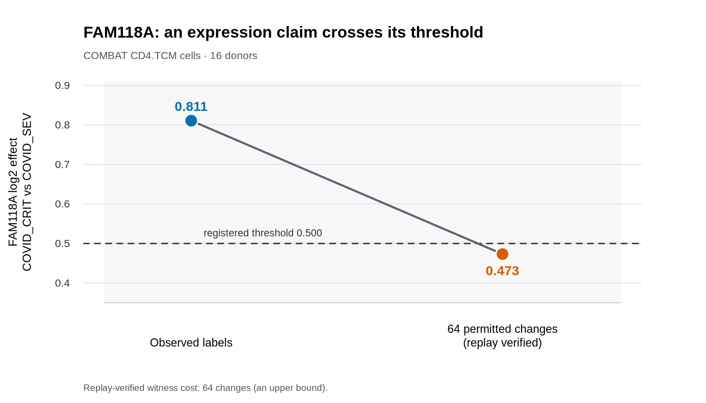

# Annotation Breakpoint

**Test whether an expression claim depends on permitted cell-label changes.**

Annotation Breakpoint refits a predeclared donor-level edgeR pseudobulk model
after controlled single-cell annotation reassignments and independently replays
any witness it finds.

[Release 0.3.0](https://github.com/yhengaa/AnnotationBreakpoint/releases/tag/v0.3.0)
· [Zenodo](https://doi.org/10.5281/zenodo.23353292)
· [Workflow tutorial](vignettes/annotation-breakpoint.Rmd)
· [FAM118A walkthrough](docs/FAM118A_WALKTHROUGH.md)



In the saved FAM118A example, 64 permitted label changes moved the fitted
COVID_CRIT versus COVID_SEV effect from 0.811 to 0.473. The replayed result is
a verified upper bound on sensitivity cost.

## Install

Install the 0.3.0 source release with R 4.5.x:

```sh
Rscript -e 'install.packages(c("BiocManager", "digest", "jsonlite", "yaml")); BiocManager::install(version="3.21"); BiocManager::install("edgeR")'
curl -L -O https://github.com/yhengaa/AnnotationBreakpoint/releases/download/v0.3.0/AnnotationBreakpoint_0.3.0.tar.gz
R CMD INSTALL AnnotationBreakpoint_0.3.0.tar.gz
```

The supported Python interface uses this installed R engine:

```sh
python -m pip install \
  "annotation-breakpoint-python @ git+https://github.com/yhengaa/AnnotationBreakpoint.git#subdirectory=python"
```

Python 3.10+ is supported. The bridge is separately versioned at 0.1.0 and has
no third-party Python runtime dependencies. See the [Python guide](docs/PYTHON.md)
for API use, exact search, runtime policy, and explicit executable paths.

Authoritative reproduction uses R 4.5.0 and edgeR 4.6.3; see the [workflow
vignette](vignettes/annotation-breakpoint.Rmd) and [declared dependencies](DESCRIPTION).
For a patch difference, request:

```sh
Rscript --vanilla "$AB_CLI" --allow-version-mismatch [other options]
```

## Quick start

Run the bundled toy example with the default `proxy_prefix` search:

```sh
AB_CLI="$(Rscript --vanilla -e 'cat(system.file("exec", "annotation-breakpoint", package="AnnotationBreakpoint"))')"
AB_EXAMPLE="$(Rscript --vanilla -e 'cat(system.file("extdata", "examples", "exact_toy", package="AnnotationBreakpoint"))')"

Rscript --vanilla "$AB_CLI" \
  --input-dir "$AB_EXAMPLE" \
  --layer-a \
  --output-dir ab-output/quickstart
```

This is a portable workflow demonstration; the public COMBAT example uses the
edgeR backend described in the [FAM118A walkthrough](docs/FAM118A_WALKTHROUGH.md).

The same authoritative workflow is available from Python:

```python
from annotation_breakpoint import run_annotation_breakpoint

run = run_annotation_breakpoint(
    input_dir="inputs/FAM118A",
    analysis_spec="analysis_specs/FAM118A.yaml",
    output_dir="results/FAM118A",
)
print(run.status, run.witness_found)
```

## Method

`proxy_prefix` ranks permitted single-cell changes once, fully refits each feasible
cumulative prefix, and replays the smallest crossing. The default sizes are
1, 2, 4, 8, 16, 32, 64, and 128.

Supply an optional strictly increasing positive schedule with:

```sh
--prefix-sizes 1,3,6,12
```

The chosen schedule is logged with the result. For small problems, use exact
enumeration with `--method exact`; it supports at most 12 ambiguous cells and
4,096 allowed assignments.

## Inputs and outputs

An input directory contains `counts.tsv` (or sparse `counts.rds`), `cells.tsv`, `specimens.tsv`,
`allowed_labels.tsv`, `claim.tsv`, and `constraints.tsv`. See the [input
reference](man/validate_inputs.Rd), [workflow vignette](vignettes/annotation-breakpoint.Rmd),
and [COMBAT reconstruction guide](inst/doc/COMBAT_REPRODUCTION.md).

The CLI writes JSON and TSV records plus `report.md`, including hashes, runtime
identity, fit accounting, changed cells, donor pseudobulks, and replay outcome.
See the [output reference](man/render_report.Rd) for the artifact contract.

| Status | Meaning |
| --- | --- |
| `exact_minimum` | A verified witness exists and every cheaper feasible assignment was ruled out |
| `verified_counterexample` | A replayed witness gives an upper bound; no minimum is certified |
| `exhaustively_stable` | Every feasible assignment fitted and none crossed the threshold |
| `no_counterexample_found` | No witness was found within the recorded practical search |
| `original_claim_not_met` | The original labels did not satisfy the strict claim |
| `not_assessable` | The requested analysis could not produce an evaluable result |
| `invalid_input` | Static validation failed |

## Interpretation

The claim holds when `q * beta > delta + tolerance` and is overturned at or below
that boundary. A practical-search witness is a verified upper bound, while an
exact minimum or stability status requires exhaustive evidence. Every result is
conditional on the declared problem; it does not identify correct labels or a
change in statistical significance.

## Saved examples and evidence

These saved upper bounds use COMBAT CD4.TCM cells, a COVID_CRIT versus
COVID_SEV contrast across 16 donors, threshold 0.5, and the registered global
445-change limit plus donor-specific caps.

| Gene | Original beta | Replayed beta | Cost | Result |
| --- | ---: | ---: | ---: | --- |
| FAM118A | 0.8106752562 | 0.4731965904 | 64 | verified upper bound |
| PDXK | 0.7274641768 | 0.3373883736 | 32 | verified upper bound |

The [evidence index](reports/PUBLICATION/README.md) preserves the development
comparison and earlier negative and inconclusive findings; the evidence did not
support a distinct search-method contribution.

## Related work and citation

Related sensitivity perspectives include [Baer et al. (PNAS, 2021)](https://doi.org/10.1073/pnas.2105254118)
([PubMed](https://pubmed.ncbi.nlm.nih.gov/34848537/)) and [Shiffman, Giordano,
and Broderick (2023)](https://arxiv.org/abs/2312.06159). The `proxy_prefix`
proposal score is an observed-centered finite-change adaptation, not a reproduction.

Use `citation("AnnotationBreakpoint")` for the package citation.
The archived 0.3.0 release is available from Zenodo at
[doi:10.5281/zenodo.23353292](https://doi.org/10.5281/zenodo.23353292).
AnnotationBreakpoint is distributed under the [MIT License](LICENSE.md).
